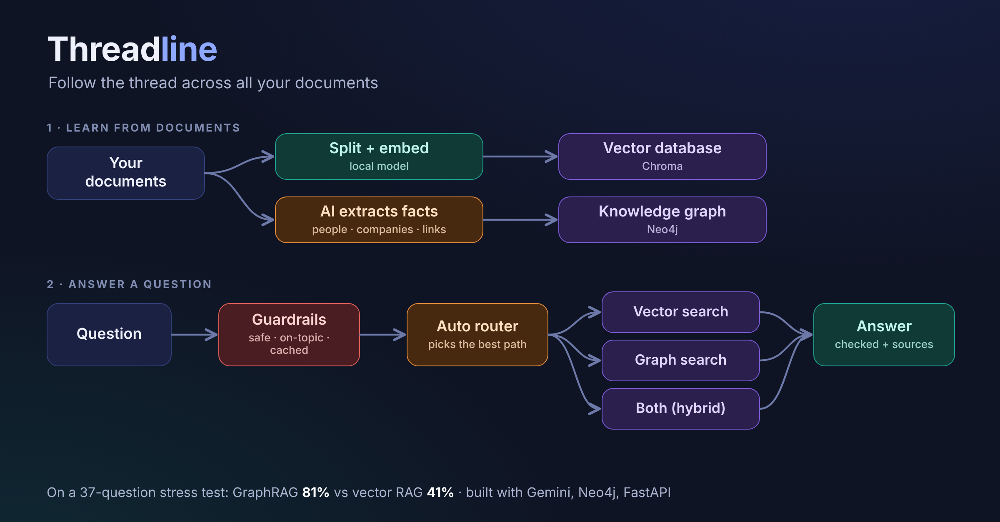
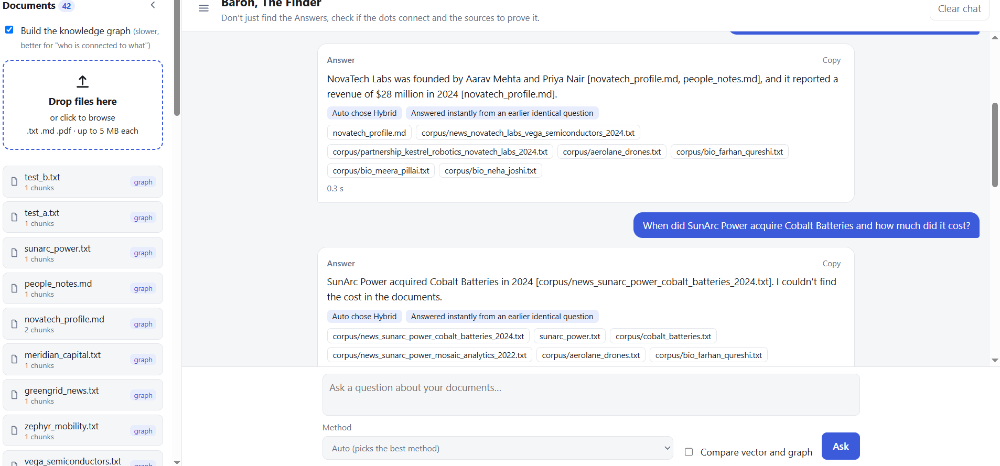
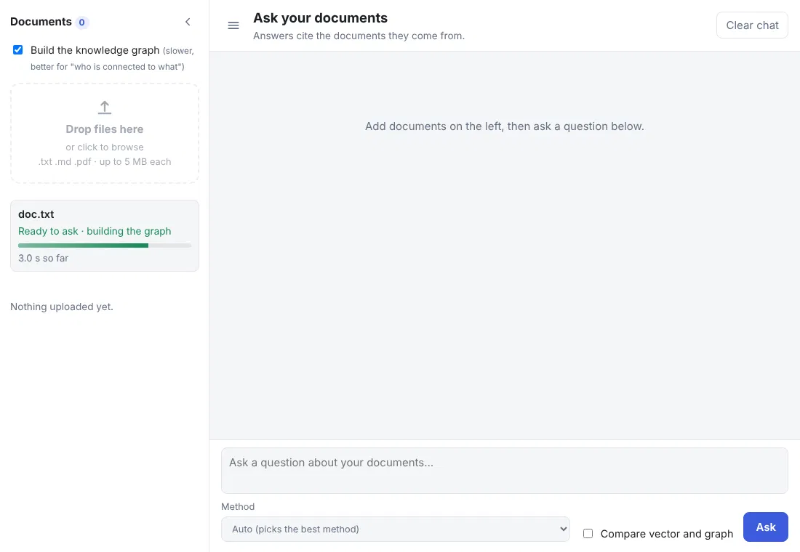
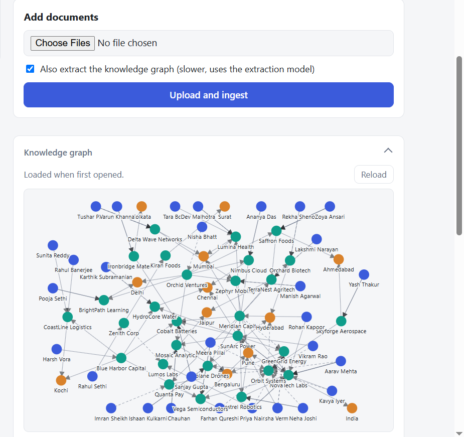

# GraphRAG: Graph vs Vector RAG with an Auto Router

A question-answering system over unstructured documents that builds a **Neo4j knowledge graph** from text, answers questions with **vector RAG, GraphRAG or a hybrid**, and picks the route automatically. It runs entirely on free resources: the **Gemini free tier**, a local Neo4j in Docker, Chroma, local MiniLM embeddings, FastAPI and a plain HTML/JS UI.

The point of the project is a measured answer to one question: **when does a graph beat plain vector search, and when does it not?** Everything below is backed by a reproducible evaluation harness.

---

## Architecture & Interface

### System Flowchart


### Application Screenshots
| Chat Page | Screenshot 2 | Screenshot 3 |
| :---: | :---: | :---: |
|  |  |  | !
[Screenshot 4](assets/screenshot_4.png) |

## Quick start

1. Copy the example environment file to create your local configuration:
   ```bash
   cp .env.example .env
   ```

2. Start Neo4j in the background using Docker Compose:
   ```bash
   docker compose up -d
   ```

3. Run the ingestion pipeline:
   ```bash
   python -m app.ingest
   ```

## Headline results

Stress corpus: 35 short documents plus 5 core documents, 37 questions, facts deliberately scattered across files. Vector RAG was limited to the **top 2 chunks** (`vector@2`) so that retrieval limits show up clearly. Graph mode used 3 hops, 80 edges and a 4000-token context.

| Question type | Questions | Graph | Vector (top 2) |
|---|---|---|---|
| Aggregation ("which companies has X invested in?") | 12 | **100%** (12/12) | 17% (2/12) |
| Multi-hop (2-3 relationship steps) | 12 | **83%** (10/12) | 0% (0/12) |
| Single-fact | 5 | 100% (5/5) | 100% (5/5) |
| Needle (dates, amounts, descriptions) | 5 | 20% (1/5), 4 correctly abstained | **100%** (5/5) |
| Guard (unanswerable, must refuse) | 3 | 100% (3/3) | 100% (3/3) |
| **Overall strict correctness** | 37 | 81% on the first run, higher after the fixes below | 41% (15/37) |

Notes on how to read this:

- The graph mode figure of 81% was measured on the full 37-question run. After that run I changed the prompt, raised the hop limit to 3 and added entity-grouped context, then re-ran only the three failing questions. mh08 is now correct and mh02 is correct on recall; mh09 is still unreliable (see Limitations). The 83% multi-hop figure combines the full run with those targeted reruns, so treat it as approximate and re-run the full set to confirm.
- Graph mode is **not** expected to answer needle questions: the graph stores relationships, not dates or amounts. Abstaining ("I couldn't find this in the documents") is the correct behaviour there. Counting correct answers plus correct abstentions, graph mode scores **92% (34/37)** on the full run.
- On the 29 questions a graph *can* answer, graph scored **90%** (recall 96%) versus **24%** (7/29, recall 36%) for vector@2.
- **Why vector fails is measured, not guessed.** For each question the runner computes how many documents hold the needed facts and the best coverage a *perfect* retriever could reach. Aggregation questions need about 4 documents on average (best case with top-2: 61%, top-4: 90%). Multi-hop questions need about 5.7 documents (top-2: 57%, top-4: 78%). Vector accuracy of 17% and 0% is therefore a retrieval-structure limit, not an embedding-quality problem.
- Latency (excluding free-tier rate-limiter waits): graph p50 1.8 s, p95 30 s on the full run; vector@2 p50 1.3 s, p95 12 s. The graph p95 is driven by the large 3-hop context and Gemini thinking time.

**Takeaway:** use the graph for relationship, list and multi-hop questions, and vector search for facts that live inside one passage. The Auto router implements exactly that split, and escalates to hybrid when the graph says "not found".

---

## Architecture

```
                          +-------------------------------+
 data/raw (.txt/.md/.pdf) |  ingest.py                    |
 or UI upload  ---------->|  chunk -> embed -> Chroma     |
                          |  chunk -> Gemini extraction   |
                          |  -> validate -> Neo4j         |
                          +-------------------------------+

 question --> guardrails --> cache --> rule answers --> router --> vector | graph | hybrid
                |              |          |               |             |
         injection, smalltalk, exact +   Cypher counts   cues, entity   answer + sources
         off-topic, length    semantic   and lists       links, LLM     + grounding check
                                         (0 LLM calls)   fallback       + escalation
```

**Pipeline order for every question** (`app/pipeline.py`):

1. **Input guard**: length limit, prompt-injection patterns, smalltalk and off-topic detection (embedding similarity, vetoed if a known entity is mentioned). Blocked questions cost 0 LLM calls.
2. **Cache**: exact match, then semantic match (cosine >= 0.92) in SQLite.
3. **Rule answers**: pure-Cypher counts and lists ("how many companies has X acquired?") with no LLM call.
4. **Router** (Auto mode), in this order: no entity found -> vector; graph cue words -> graph; vector cue words -> vector; both -> hybrid; two or more linked entities -> graph; otherwise one small flash-lite call, falling back to `DEFAULT_ROUTE`. Cue lists live in `config.yaml` (about 80 graph cues, 59 vector cues).
5. **Answer**: vector (top-k chunks), graph (k-hop neighbourhood plus shortest paths) or hybrid (both).
6. **Escalation**: in Auto mode, a graph route that returns "not found" is retried as hybrid and flagged with an `escalated` badge.
7. **Relevance gate and grounding check**: low-similarity retrieval returns "not found" without calling the LLM; answers whose names or numbers do not appear in the context are flagged.

### Knowledge graph

- Nodes: `Person`, `Company`, `Location`, `Document`.
- Relations (whitelist): `WORKS_AT`, `FOUNDED`, `CEO_OF`, `INVESTED_IN`, `ACQUIRED`, `PARTNERED_WITH`, `LOCATED_IN`.
- Every edge carries `status` (current/past), `evidence` (a quoted phrase from the source) and `source` (document name). Edges are keyed by (a, relation, b, source), so the same fact from two documents stays traceable.
- Extraction uses Gemini with a versioned prompt (`PROMPT_VERSION v3`), an entity resolver (aliases plus fuzzy matching) and a validator that drops anything outside the whitelist. Extraction results are cached in `data/extract_cache.sqlite`, so re-ingesting costs no quota.

### Graph context for the LLM

`graph_neighborhood` walks up to 3 hops, ordered nearest-first, capped at 80 edges. The context sent to the model has three parts: shortest-path lines between linked entities, a **Summary by entity** (one line per entity listing all facts in both directions, e.g. `NovaTech Labs: founded by Aarav Mehta, Priya Nair; CEO Aarav Mehta; invested in by Meridian Capital`), and every fact with its source quote. Relations are written as plain English ("works at", "invested in") because raw names such as `CEO_OF` caused grounding false positives and were echoed back by the model.

### Free-tier handling

A client-side sliding-window limiter (`GEMINI_RPM`, default 9) keeps within the free quota, the router uses the separate flash-lite quota, and a fallback model takes over when the main model is rate-limited. Reports exclude limiter wait from latency and show how many questions used the fallback.

---

## Quick start (Windows PowerShell)

```powershell
# 1. Environment
python -m venv .venv
.\.venv\Scripts\Activate.ps1
pip install -r requirements.txt
copy .env.example .env          # then set GEMINI_API_KEY and NEO4J_PASSWORD

# 2. Neo4j
docker compose up -d
docker compose ps               # neo4j should be "running"

# 3. Ingest the documents (vectors + graph)
python -m app.ingest            # data/raw/**, incl. data/raw/corpus/
python -m eval.check_graph --with-corpus   # extraction precision / recall vs gold triples

# 4. Run the app
uvicorn app.api:app --port 8000
# user page: http://localhost:8000    developer page: http://localhost:8000/dev
```

Useful variants: `python -m app.ingest --no-graph` (vectors only), `--graph-only`, or a path to a single file. `python -m app.seed` loads the hand-written gold graph without calling the LLM (core documents only).

### Web UI

Two pages:

- **User page `/`**: chat only, with a retractable documents sidebar and a drag-and-drop upload zone. Each file shows live progress (queued, reading, indexing, **ready to ask** while the graph is still building, done / already ingested / error) with time and LLM calls, and example questions are built from the user's own documents. Choose the method (Auto, Graph, Vector, Hybrid) and optionally compare vector and graph side by side. Visitors see the answer, method used, sources and time, never the retrieved context, prompts, models or costs.
- **Developer page `/dev`**: password-protected (`DEV_PASSWORD` in `.env`, login page with a signed cookie, failed-login lockout). Everything from before (graph panel with highlighted edges, metrics, health and model pills, compare) plus collapsible panels for the graph (loaded on first open) and a **document manager** (counts, re-ingest, delete), an **evaluation report viewer** with run-to-run comparison, an **extraction quality** check against the gold triples, a **router playground**, an **Inspect** view per answer (router reason, timings, rate-limiter wait, grounding, sources) and a **settings** view with secrets hidden.

Uploads are stored in `data/raw/uploads/` (they never overwrite the core documents). An **ingest registry** (SHA-256 per document) means the same file, or the same content under another name, is never embedded or extracted twice; an edited file replaces its old vectors and graph facts. Upload limits (file size, files per upload, uploads and questions per IP) are set in `.env`.

### API

| Endpoint | Access | Purpose |
|---|---|---|
| `POST /ask`, `POST /compare` | public, rate-limited | Answer with `route: auto\|vector\|graph\|hybrid` (trimmed response) |
| `POST /ingest`, `GET /ingest/jobs/{id}` | public, limited | Upload files, poll per-file progress |
| `GET /health`, `/kb/status`, `/kb/docs`, `/kb/suggest` | public | Minimal status, document names and counts, example questions |
| `POST /auth/login`, `/auth/logout`, `GET /auth/me` | public | Developer session |
| `POST /dev/ask`, `/dev/compare`, `GET /dev/health`, `/dev/settings`, `/dev/docs` | developer | Full responses and diagnostics |
| `DELETE /dev/docs?source=`, `POST /dev/docs/reingest?source=` | developer | Document manager |
| `GET /dev/eval/reports`, `/dev/eval/report?name=`, `/dev/extraction` | developer | Evaluation reports, extraction precision/recall |
| `GET /metrics`, `/graph/summary`, `/graph/link`, `/route` | developer | Counters, graph data, router debugging |

---

## Configure without touching code

| What | Where |
|---|---|
| Models, limits, thresholds, passwords, app name | `.env` (see `.env.example`, every line is documented) |
| A different Google account per task (answer / extraction / router / fallback) | `.env`: `ANSWER_API_KEY`, `EXTRACTION_API_KEY`, `ROUTER_API_KEY`, `FALLBACK_API_KEY`. Blank = `GEMINI_API_KEY`. |
| Extra node types such as `Year` (relation rule generated automatically) | `.env`: `EXTRA_NODE_TYPES=Year`; fine-tune in `config.yaml` → `extra_node_types` |
| Node labels, relation rules, aliases, router cues, guardrail lists, canned replies | `config.yaml` |
| Answer and extraction prompts | `config.yaml` → `prompts` (empty = built-in text) |

After changing `EXTRA_NODE_TYPES` or the relation rules, rebuild the graph: `python -m app.ingest --graph-only --force`.

## Evaluation

```powershell
python -m pytest -q tests                                              # offline tests
python -m eval.run_eval                                                # 49 core questions, auto mode
python -m eval.run_eval --modes auto,vector,graph                      # compare modes
python -m eval.run_eval --questions eval/questions_corpus.yaml --modes graph,vector@2 `
    --env GRAPH_MAX_EDGES=80 --env MAX_CONTEXT_TOKENS=4000             # stress test
python -m eval.run_eval --resume eval/results/<folder>                 # continue after a quota error
```

| Asset | Content |
|---|---|
| `eval/questions.yaml` | 49 core questions with expected keywords and route |
| `eval/holdout_questions.yaml` | 18 unseen routing questions (cue generalisation check) |
| `eval/questions_corpus.yaml` | 37 stress questions: 12 aggregation, 12 multi-hop, 5 needle, 5 single, 3 guard |
| `eval/gold_triples*.yaml` | 5 hand-labelled core documents plus 92 corpus triples |
| `data/raw/corpus/` | 35 generated documents (18 company profiles, 2 investors, 6 acquisition news, 5 partnerships, 4 bios) built deterministically by `eval/build_corpus.py` |

Metrics reported per run: strict correctness (all expected items present), **recall**, **precision** (extra names listed, such as a person wrongly called an alumnus), router accuracy, abstention behaviour, LLM calls per question versus a plain-RAG baseline, zero-call share, latency per route (p50/p95, limiter wait removed), ungrounded flags and fallback usage. Reports also print the settings and any `--env` overrides, so every number can be reproduced.

---

## Engineering decisions worth noting

- **Fair judging of graph mode.** An early report scored graph mode at 43% because it was judged on needle questions it cannot answer. Scoring now accepts correct abstention and breaks results out per type and for graph-capable questions.
- **Corpus built to be honest.** Four multi-hop questions were not truly cross-document (the answer sat in one file) and were rewritten, so the vector baseline is not handicapped unfairly. Evidence-spread statistics are computed from the data, independent of any model.
- **Nearest-first neighbourhood.** A plain `LIMIT` on a hub entity dropped arbitrary edges; ordering by hop depth keeps the closest facts.
- **Grounding false positives** from raw relation names fixed by verbalising relations.
- **Offline tests (114 passing)** cover router decisions on core, holdout and corpus questions, corpus integrity (documents, gold triples and questions must agree), graph context formatting, escalation and the scoring helpers.

---

## Known limitations

1. **Multi-hop list questions are not fully reliable.** In the final reruns the graph context contained every required fact, but the model still dropped or added items between runs (mh09 lost two correct alumni in one run; mh02 added a person who never worked at the company). Temperature is already 0. This is the main motivation for the roadmap item below.
2. **Needle questions need vector.** The graph has no dates or amounts; use Auto or Hybrid.
3. **Extraction quality bounds everything.** Run `python -m eval.check_graph --with-corpus` after ingesting and read the missing/wrong triples before trusting query results.
4. **Free-tier quotas.** Full runs can hit rate or daily limits; `--resume` continues where a run stopped. Results vary slightly between runs because Gemini is not fully deterministic.
5. The Cypher for the nearest-first ordering has a fallback to the older unordered query if it fails on a given Neo4j version.
6. Figures above come from my runs on the 35-document corpus; they are not a benchmark of general performance.

---

## Roadmap (next version)

**Cypher-assisted answers** (planned, not built):

- For multi-hop and list questions, the LLM writes a **read-only Cypher query** from the graph schema; Neo4j executes it, and the LLM only turns the returned rows into prose.
- A validator blocks write keywords, unknown relation types and unbounded results (row cap, about 50), and the query runs in a read-only transaction.
- If the query fails or returns no rows, fall back to the current graph-context path.
- Expected effect: exact joins and no invented members, at the cost of one extra LLM call per graph question and some free-tier quota. Needs about 15 new tests including injection attempts, and a re-run of the 12 multi-hop questions with the new precision metric to confirm the gain.

Other ideas: a precision-aware answer check that rejects names with no supporting edge, 3-run voting for the hardest questions, and a LangSmith-style trace view in the UI.

---

## Project layout

```
app/        api.py  security.py  registry.py  jobs.py  pipeline.py  router.py  rag.py  extract.py  ingest.py  stores.py
            guardrails.py  cache.py  llm.py  config.py  seed.py
static/     user.html user.js user.css upload.js upload.css login.html style.css   (public)
private/    dev.html dev.js dev.css                                               (served only after login)
eval/       run_eval.py  check_graph.py  build_corpus.py  questions*.yaml  gold_triples*.yaml
tests/      test_router.py  test_routing_set.py  test_graph_context.py  test_corpus.py
            test_security.py  test_registry.py  test_ingest_dedup.py  test_api_access.py
data/raw/   5 core documents + corpus/ (35 generated documents)
config.yaml router cues, relation rules, aliases, guardrail lists, canned messages
```

Never commit `.env`, `data/chroma/`, the SQLite caches or `eval/results/`.
